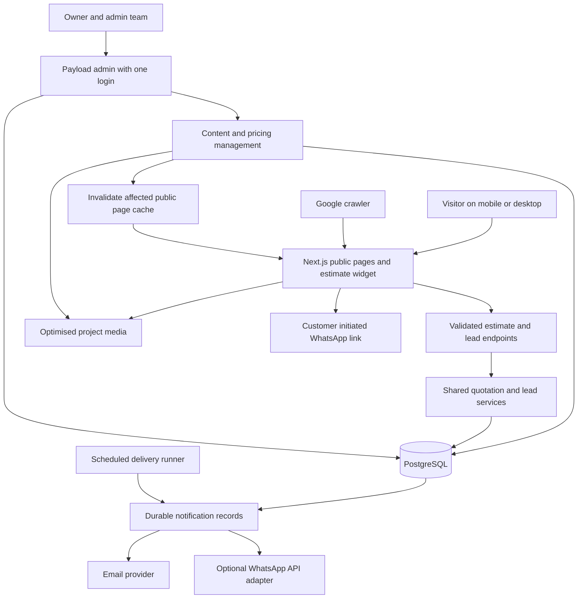
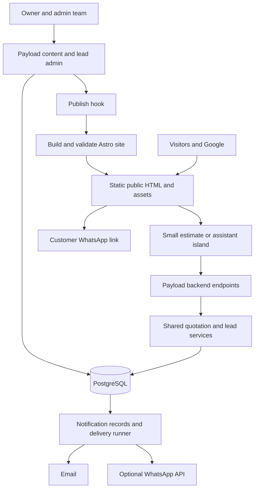
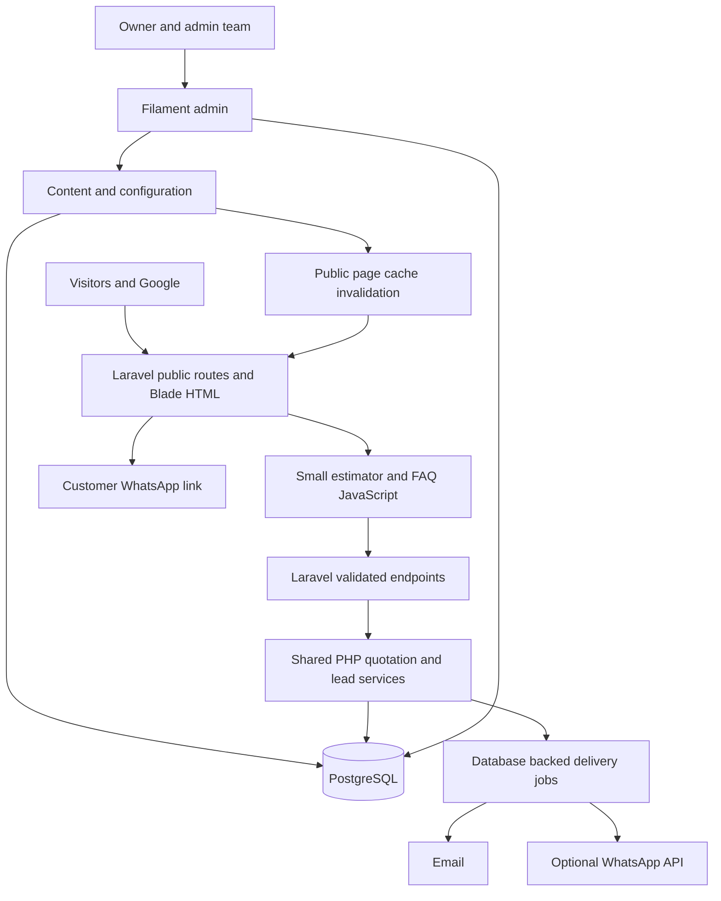
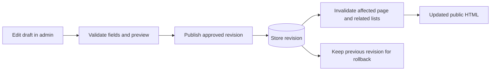
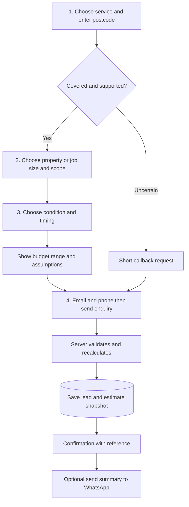
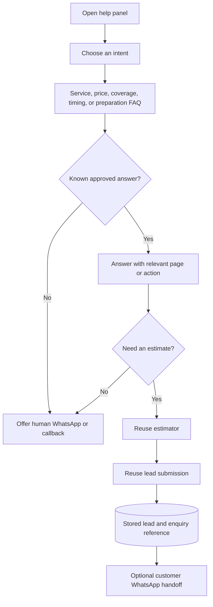
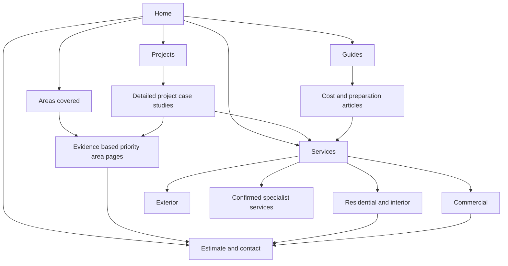
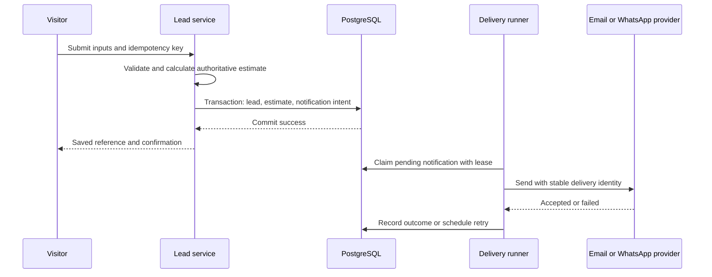
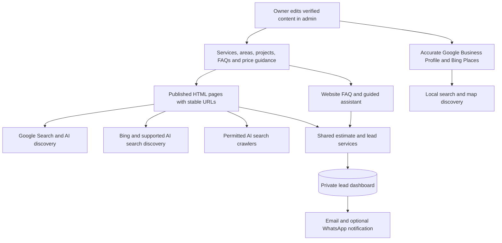

# Levant: website architecture, local SEO, and lead generation plan

**Prepared:** 11 October 2026  
**Business:** Levant Painting & Decorating — [existing website](https://levant-painting.co.uk/)  
**Status:** proposal for choosing the architecture before implementation. No production changes made.  
**Scope:** responsive marketing website, quick estimates, shared lead dashboard, editable content/pricing, WhatsApp handoff, optional guided chatbot, and ongoing local SEO.

**Technology review added:** Google Search, Maps, AI discovery, and Next.js/Laravel/Python comparison — see [section 23](#23-focused-technology-decision-google-maps-ai-discovery-and-future-features).

**Reading guide:** [recommendation](#1-my-recommendation) · [three architecture choices](#5-three-complete-architecture-choices) · [stack](#6-concrete-stack-for-choice-a) · [admin dashboard](#9-the-shared-lead-dashboard) · [estimate journey](#11-quick-estimate-four-short-screens) · [WhatsApp](#12-whatsapp-handoff-versus-automation) · [assistant packages](#13-the-2030-question-assistant-and-how-to-sell-it) · [local SEO](#14-local-seo-plan) · [eight-week programme](#19-eight-week-delivery-and-seo-programme) · [costs](#21-costs-ownership-and-risk).

## 1. My recommendation

**Choose TypeScript + Next.js + Payload CMS + PostgreSQL, in one application and one repository.** Use pre-rendered or cached public pages, small interactive components, and a protected Payload admin for both content and leads. Start with an estimate wizard, reliable lead storage, email notifications, and ordinary WhatsApp links. Sell the guided FAQ assistant as a separate, clearly scoped addition.

This choice fits the complete requirement: the owner can manage photos, blogs, offers, FAQs, estimate prices, and enquiries through one login. Payload supplies a configurable admin and authentication; we build the quotation rules and the few dashboard views the business needs. Its documented capabilities include database migrations, access control, uploads, and preview. [Payload overview](https://payloadcms.com/docs/getting-started/what-is-payload)

The language is TypeScript for the public website, backend, and admin configuration, with SQL for durable storage. Its benefit here is shared types and fewer mismatches between forms, pricing, and dashboard data. Google does not give a website a higher rank because its developer used TypeScript, PHP, Astro, or Next.js.

For the narrowed language shortlist, **Laravel + Filament** is the closest alternative, followed by **Python + Django + Wagtail** when Python is the preferred maintenance language. **Astro + Payload** remains an option if static public delivery outweighs maintaining two applications. These approaches can all produce excellent SEO and attractive mobile interfaces; the focused comparison is in section 23.

The outcome to optimise is **qualified enquiries that become profitable jobs**. Rankings, traffic, and chatbot interactions help us diagnose that outcome; they are not substitutes for it. [B3](RESEARCH_NOTES.md#b3-seo-fitness-workbook)

### The two-month expectation

Treat eight weeks as a delivery and improvement period. We can aim to preserve existing search traffic, remove technical barriers, improve priority pages, strengthen the business profile, and make enquiries easier. We cannot promise number one across London, across every service, or within a fixed deadline. Google explicitly says there is no technique that automatically produces first place, and changes can take hours through several months to affect results. [Google SEO Starter Guide](https://developers.google.com/search/docs/fundamentals/seo-starter-guide)

Local Maps results also depend on relevance, distance, and prominence. A better website cannot move the business physically closer to every searcher. [Google local ranking guidance](https://support.google.com/business/answer/7091?hl=en)

## 2. What I inspected, and what remains unknown

I inspected five of the twelve supplied desktop screenshots, the public homepage and areas page through web browsing, selected sections from seven local books, official platform documentation, and relevant Reddit/Stack Overflow discussions. This is a planning review, not a full crawl or authenticated audit.

| Evidence | Observation | Implication |
| --- | --- | --- |
| Supplied homepage screenshots | Existing navy/gold identity, real project images, service links, and quote buttons | Improve this identity and proof rather than replacing everything without a reason |
| Public navigation and homepage | Residential/commercial/exterior decorating, wallpapering, coving, epoxy feature walls, and epoxy flooring are advertised | Confirm the services actually sold, margins, and capacity before setting priorities |
| Supplied WordPress pages screenshot | Admin shows 77 page items and numerous commercial service/location titles | Inventory existing URLs and search performance before reducing or reorganising pages |
| Supplied editor screenshot | Contact-page meta description field appears empty | Check published metadata across the site; the screenshot alone does not prove the live page lacks a description |
| Public text representation | Generic image labels, extra heading text, and counters rendered as zero appear | Verify the original HTML and browser behaviour; avoid zero-value counters and improve meaningful image descriptions |
| Desktop screenshots | Large decorative sections and a floating contact control | Test a more direct path from service proof to estimate; mobile quality is currently unmeasured |

The advertised services and broad London coverage are visible on the [homepage](https://levant-painting.co.uk/) and [areas page](https://levant-painting.co.uk/areas-we-cover/). These are business claims, not independently verified credentials.

**Unknown:** priority neighbourhoods, actual business base, Business Profile verification/reviews, Search Console traffic, existing leads, backlinks, hosting contract, quote rates, VAT status, team response capacity, and access ownership. Roofing is unconfirmed. Do not create roofing pages simply because the brief mentioned roofs.

Direct shell requests could not resolve the domain in this environment. I have not measured live Core Web Vitals, crawled all 77 pages, checked every redirect, or accessed the client's accounts. Cached/search-tool representations can differ from the current browser page.

For planning, examples use London, Enfield, Barnet, and Camden because the material shows London coverage. These are illustrative targets, pending the owner's priority list. No keyword volume or Google position below is presented as measured.

## 3. Book foundation

I reviewed relevant sections from **seven books**, rather than claiming to have read seven books cover to cover. The linked research notes record exact files, sections, and PDF page positions. Books inform the design principles; current official guidance overrides obsolete tactics.

| Book | Relevant material reviewed | Decision it informs |
| --- | --- | --- |
| **B1 — Steve Krug, Don't Make Me Think, Revisited** | Clarity, scanning, familiar controls, mobile usability | Obvious service/location proposition, short forms, visible touch controls |
| **B2 — Adam Clarke, SEO 2025** | Intent, on-page structure, local search | Prioritise purchase intent and useful service pages; connect site and Business Profile |
| **B3 — Jason McDonald, SEO Fitness Workbook, 2021** | Goals, local reviews, metrics | Measure the search-to-enquiry-to-job funnel and report monthly work |
| **B4 — Eric Enge and Adrián Ridner, Using Generative AI for SEO** | Useful content and human review | Use actual project evidence and owner review; avoid bulk generic AI pages |
| **B6 — Mark Richards and Neal Ford, Fundamentals of Software Architecture, second edition** | Architectural characteristics and tradeoffs | Prioritise performance, reliability, maintainability, privacy, and owner usability |
| **B7 — Robert C. Martin, Clean Architecture** | Boundaries and separating business rules from delivery/storage | One quote engine reused by wizard and chatbot; provider adapters outside business logic |
| **B8 — Building Evolutionary Architectures, second edition** | Fitness functions and measurable architectural constraints | Protect performance, public/private boundaries, and lead reliability with meaningful checks |

Full annotations and local source links: [Research notes](RESEARCH_NOTES.md). The scanned information-architecture PDF is listed there as excluded; it was not readable as extracted text.

## 4. Product scope and priorities

### Launch baseline

- Public home, services, useful area pages, project case studies, about, reviews, contact, privacy, and necessary terms.
- A four-screen estimate journey for supported services, with a short callback fallback for unusual work.
- Mobile call/quote/WhatsApp actions and desktop equivalents.
- Persistent lead records, acknowledgement, email delivery with retries, and an admin dashboard.
- Owner editing of business content, images, offers, FAQs, and validated pricing settings.
- URL migration controls, metadata, sitemap, relevant structured data, and search/lead measurement.
- Secure admin roles, backups, deployment documentation, and training.

### Separately scoped additions

Guided FAQ assistant, automatic WhatsApp notifications, customer file uploads, calendar booking, deeper sales reporting, additional languages, and external CRM integration. The architecture accommodates these without requiring them for launch.

“All editable” means business information and approved design blocks can change in admin. Pricing formulas, permission logic, database migrations, and integrations remain reviewed code. Letting an owner paste arbitrary scripts or rewrite executable pricing logic would make maintenance harder.

## 5. Three complete architecture choices

These are engineering judgements for this brief, not framework benchmarks or ranking predictions. Indicative monthly operating budgets exclude your labour, VAT, advertising, paid SEO tools, and unusually high usage.

### Choice A — Next.js + Payload + PostgreSQL: recommended

**Composition:** TypeScript, React, Next.js App Router, Payload, PostgreSQL, CSS/Tailwind, object storage, transactional email, and scheduled notification processing. One application serves the public site, admin, and controlled endpoints.



**How it behaves:** public pages contain useful HTML before visitor JavaScript runs. Interactive components are limited to the estimator, filters, mobile navigation, and optional assistant. Admin and personalised responses are dynamic and private. Next supports separating server and client components; we must use that deliberately. [Next.js server/client components](https://nextjs.org/docs/app/getting-started/server-and-client-components)

**Pros**

- One language and one integrated admin for content and leads.
- Content schemas, permissions, revisions, and forms are generated from configuration rather than separate custom CMS code.
- Good fit for a richer lead dashboard, editable quotation rules, and future workflow additions.
- Shared quotation functions and types across the website and assistant.
- A standard Node deployment can move hosts; Vercel is optional. [Next.js self-hosting](https://nextjs.org/docs/app/guides/self-hosting)

**Cons**

- More framework/runtime machinery than a static Astro site.
- Poor caching choices or excessive client components can make it unnecessarily slow.
- Payload/Next/React upgrades need compatible versions and testing.
- You own database migrations, access rules, backups, and operational checks.
- Usually needs more hosting resources than a static brochure site; measure memory rather than choosing the smallest instance blindly.

**Indicative operation:** £40–£100/month as a planning allowance. **Implementation effort:** roughly 15–25 developer days for the complete baseline, depending heavily on migration, content, and design approval.

**Best when:** one editable admin and reliable lead workflows are central. That is this brief.

### Choice B — Astro + Payload backend: strongest public-site simplicity

**Composition:** Astro/TypeScript public website; one Payload/Node admin and backend; PostgreSQL; shared quotation package; object storage and email. Keep both applications in one repository. Payload remains the single client login.



Astro renders ordinary components without a browser runtime and adds JavaScript to explicitly interactive islands. This suits content-heavy public pages. [Astro islands](https://docs.astro.build/en/concepts/islands/)

**Pros**

- Straightforward static output and tight control over public JavaScript.
- Most public pages continue to load if the CMS/backend temporarily fails.
- Easy CDN hosting, portable HTML, and inexpensive public traffic.
- Keeps the same capable Payload admin and quote engine as Choice A.
- Good separation if you later host many similar brochure sites.

**Cons**

- Two applications, deployment configurations, and preview mechanisms.
- Content appears after a successful build; show publishing status and alert on failures.
- Pricing can change before a rebuild finishes, so estimation must use authoritative server configuration.
- Cross-origin APIs/authentication need care if placed on a separate hostname.
- Public hosting is cheap, but the required admin/backend/database still cost money.

**Indicative operation:** £40–£110/month; roughly 17–28 developer days for the complete baseline.

**Best when:** static delivery and backend outage isolation matter enough to justify two applications.

**Why not simply Astro + Sanity?** That is an excellent content-editing arrangement, but the updated brief also needs private lead records and a useful sales dashboard. A second data/admin system would dilute the simplicity. Sanity's free plan currently offers Administrator and Viewer roles; normal Editor/Contributor roles require Growth, listed at $15 per seat/month. Avoid assuming restricted owner editing is free. [Sanity pricing](https://www.sanity.io/pricing)

### Choice C — Laravel + Filament + PostgreSQL: strong PHP alternative

**Composition:** PHP/Laravel for server-rendered public pages and business services; Blade/CSS with small Alpine/JavaScript interactions; Filament for admin forms, tables, and dashboard widgets; PostgreSQL; database-backed jobs; object storage and email.



Laravel documents server templates and relational-database queue support. Filament supplies configurable admin resources and dashboard widgets. These are suitable foundations for a small business dashboard. [Blade](https://laravel.com/framework/docs/13.x/blade), [Laravel queues](https://laravel.com/framework/docs/13.x/queues), [Filament overview](https://filamentphp.com/docs/5.x/introduction/overview), [Filament widgets](https://filamentphp.com/docs/5.x/widgets/overview)

**Pros**

- One application with established validation, authorisation, mail, and queue patterns.
- Simple server-rendered public HTML can perform very well.
- Particularly comfortable for forms, admin tables, and sales workflows.
- Broad PHP hosting options; a small business does not need an expensive distributed architecture.
- Clear separation between public Blade pages and admin interactivity.

**Cons**

- Public JavaScript and server PHP cannot share the same executable quotation function. Keep the server authoritative and share data/contracts rather than duplicating formulas.
- Blog editing, SEO fields, previews, and page blocks need deliberate configuration.
- A VPS can be cheap but transfers patching, backups, and process supervision to you.
- Less reuse of React components if TypeScript/React is your preferred development direction.

**Indicative operation:** £30–£100/month; roughly 15–25 developer days for the complete baseline. Self-managed VPS pricing excludes the time to operate it.

**Best when:** you want PHP as your primary maintenance language. It has no inherent SEO disadvantage.

### Comparison and decision

| Criterion | A: Next + Payload | B: Astro + Payload | C: Laravel + Filament |
| --- | --- | --- | --- |
| Public speed potential | Excellent with restrained client code/cache | Excellent with static output/islands | Excellent with cached HTML/small JS |
| Content and leads in one admin | Strong | Strong | Strong |
| Applications to deploy | One, plus scheduler | Two, plus scheduler | One, plus job worker/scheduler |
| Shared browser/server business code | Strong TypeScript sharing | Strong TypeScript sharing | Server PHP with browser contracts |
| Owner editing | Configured Payload forms | Same Payload forms | Configured Filament forms |
| Lead dashboard extensions | Strong | Strong backend; extra public integration | Strong |
| CMS outage isolation for public pages | Cache-dependent; verify behaviour | Strong static-page isolation | Cache-dependent; verify behaviour |
| Maintenance skills | TypeScript/React/Node/SQL | Astro plus Payload/Node/SQL | PHP/Laravel plus JS/SQL |
| Guaranteed higher rankings | None | None | None |
| My fit judgement | **Best overall for this requirement** | Best for a static public-site priority | Best for a PHP maintenance preference |

**A fourth baseline: improve WordPress.** A lighter theme, reliable forms, and better content can be economically sensible if migration is too expensive. WordPress also supports custom/headless frontends through its REST API. It should not be dismissed as incapable of SEO. Your preference for a cleaner custom system, controlled estimator, and integrated dashboard makes Choice A attractive, but switching platforms alone does not justify the investment. [WordPress REST API](https://developer.wordpress.org/rest-api/)

## 6. Concrete stack for Choice A

| Responsibility | Choice | Reason |
| --- | --- | --- |
| Language | TypeScript, with strict checking | Shared contracts and explicit handling of missing/invalid data |
| Public site | Next.js App Router | HTML rendering, metadata, image handling, and room for workflow growth |
| Admin/content | Payload | Reuse existing authentication/forms instead of building a CMS |
| Database | Managed PostgreSQL | One durable store for content, leads, revisions, and delivery records |
| Styling | Tailwind/CSS with design tokens | Consistent spacing, typography, colours, and responsive layouts |
| Public widgets | React only where needed | Estimator and assistant share components without hydrating every section |
| Media | Payload object-storage adapter, e.g. S3-compatible R2 | Persistent assets survive deployments; generated responsive sizes |
| Email | Resend or equivalent behind an adapter | Delivery events and easier provider replacement |
| Lead alerts | One notification/outbox collection and scheduled processor | Durable retries without adding Redis or another queue service |
| WhatsApp baseline | Plain click-to-chat links | Minimal scripts, familiar customer action |
| Search reporting | Search Console + Business Profile performance | Search visibility and local discovery |
| Website measurement | Consent-controlled GA4 or a reviewed aggregate-only alternative | Funnel evidence with a documented privacy configuration |
| Verification | Vitest, Playwright, accessibility and page-budget checks | Protect meaningful pricing, privacy, and conversion paths |
| Hosting | Paid managed Node service and managed Postgres, initially one region | Predictable operation without managing a server OS |

**Proposed first host:** Render for Node and PostgreSQL, colocated in Frankfurt, with persistent media in object storage. Render documents Next deployment and Frankfurt availability. Final instance size, backups, spend, and data-processing terms need a pre-build check. This is a proposal, not a provisioned account. [Render Next deployment](https://render.com/docs/deploy-nextjs-app), [Render regions](https://render.com/docs/regions)

Use current mutually compatible stable versions of Next, Payload, React, Node, and database adapters; pin them in a lockfile. Confirm compatibility with a small installation/deployment spike before committing to the full build. Do not copy version numbers from an old forum answer.

Public page caching and CMS publication must be demonstrated in that spike. New pages must become routable, edited pages must update, expired offers must disappear, and private pages must never enter the public cache. Choose one documented caching model for the pinned Next version.

## 7. Clean code structure and boundaries

Use a modular monolith: business modules inside one application. Public pages, admin forms, and notifications call the same business services. Separate modules are enough; separate network services are unnecessary for this size. [B6](RESEARCH_NOTES.md#b6-fundamentals-of-software-architecture), [B7](RESEARCH_NOTES.md#b7-clean-architecture)

```text
src/
  app/
    (website)/                public routes and layouts
    (payload)/                Payload admin and framework API routes
    api/estimate/             controlled public estimation endpoint
    api/leads/                controlled public lead submission
    api/integrations/         authenticated provider callbacks
  features/
    content/                  published-content selectors and rendering
    estimates/                schemas, pure calculator, result formatting
    leads/                    submit service, permissions, status rules
    assistant/                FAQ selection and handoff components
    notifications/            delivery policy, processor, templates
    seo/                      metadata, schema, sitemap, redirect policy
  collections/                Payload collection configuration
  globals/                    business settings and approved page settings
  infrastructure/             database, media, email, WhatsApp adapters
  components/                 shared visual primitives and page blocks
  lib/                        genuinely shared utilities only
tests/                        meaningful integration and journey tests
docs/                         decisions, deployment, owner handover
```

Rules that prevent redundancy:

1. One `calculateEstimate` implementation. The server recomputes every submitted estimate.
2. One `submitLead` service used by contact, wizard, and assistant.
3. One business-settings source for telephone, email, service coverage, and structured data.
4. One FAQ collection feeding the public FAQ sections and guided assistant.
5. One notification pipeline with email and optional WhatsApp adapters.
6. One admin authentication/permission system. Reuse Payload users and roles.
7. One page schema and a small approved set of blocks, rather than independent builders for every page.
8. Snapshot historical prices in an estimate record intentionally; never recalculate an old enquiry silently after rates change.

Reuse business behaviour; do not force every visually different component into a giant configurable component.

## 8. Data model and admin editing

| Collection/global | Core information | Who edits |
| --- | --- | --- |
| Users | Role, account status, login identity | Owner/developer |
| Business settings | Display name, phone, WhatsApp, hours, coverage, verified claims | Owner |
| Services | Slug, scope, exclusions, images, related projects, SEO fields | Owner/editor |
| Areas | Actual coverage, relevant services, local evidence, SEO fields | Owner/editor |
| Projects | Service, approximate area, before/after photos, work details, permission status | Owner/editor |
| Articles | Author, body, service links, publish state, genuine modified date | Owner/editor |
| Offers | Conditions, eligible services, start/end, display priority | Owner |
| FAQs | Question, approved answer, category, aliases, related service/action | Owner/editor |
| Price books | Version, supported options, rates, inclusions, VAT display, validity | Owner |
| Estimates | Inputs, range, exclusions, applied price-book version, expiry | Server; read-only history |
| Leads | Contact, estimate reference, source, status, assignee, next action | Team/owner |
| Lead activity | Notes, status changes, quote sent, value, follow-up | Team/owner |
| Notifications | Channel, lead reference, attempts, lease, outcome, provider ID | System; operator retry controls |
| Redirects | Old URL, target, status, reason | Owner/developer with validation |

Persist a lead independently of whether its email or WhatsApp alert is delivered. Leads and content share the database, but they have different access permissions.

### Publishing behaviour



Owner tasks should be forms such as “add a project,” “publish a blog,” and “change an offer.” Require image descriptions, relevant service links, and offer conditions where appropriate. Provide a mobile preview and a confirmation of publication state.

Pricing changes create a new price-book revision. Validate ranges, minimum charge, supported options, and tax configuration. Let the owner test example jobs before activating a revision. Old estimates retain their original version and snapshot.

## 9. The shared lead dashboard

The dashboard is a simple operational tool. Start with four useful cards: new enquiries, awaiting response, estimates/quotes sent, and jobs won. Below them show the lead list and follow-ups due. Avoid decorative charts without a decision attached.

```text
Leads dashboard
  New: 8     Awaiting response: 3     Quotes sent: 5     Won: 2

  Filters: date | service | area | source | status | assignee

  Received    Customer       Job and area       Estimate       Status
  Today       A. Customer    Interior / EN...   Range saved    New

  Lead detail
    Call | WhatsApp | Email
    Service + property + condition + requested timing
    Estimate snapshot and exclusions
    Source page and campaign, where known
    Assignee, next follow-up, notes, activity, delivery status
```

The numbers above are illustrative UI placeholders, not client data.

**Lead lifecycle:** New → Contacted → Survey booked → Quote sent → Won/Lost. Include Spam/Duplicate as separate dispositions. A budget estimate does not automatically mean a staff quote was sent.

**Roles:** owner manages settings and staff; editor manages public content; team member manages permitted leads; developer maintains infrastructure. Enforce permissions at the collection, field, and endpoint level. A hidden menu is not a security boundary. [Payload access control](https://payloadcms.com/docs/access-control/overview)

Allow CSV export for authorised users, neutralising spreadsheet formula injection. Show overdue follow-ups and failed notifications. Store loss reasons and actual agreed values so SEO reports can distinguish cheap traffic from worthwhile work.

## 10. Customer experience and visual direction

Keep the navy/gold identity if the owner likes it, but use gold as an accent and test contrast. Use real finished-work photography, readable text, and a calmer page structure. Every screen should make it clear what the business does, where it works, and how to enquire. [B1](RESEARCH_NOTES.md#b1-dont-make-me-think-revisited)

### Homepage order

1. Short hero: main service + priority area, one verified differentiator, a good completed-work photo, primary “Get an estimate” action, and phone alternative.
2. Genuine reviews/credentials with source links and verified wording.
3. Clear service cards with descriptive names.
4. Selected before/after projects with service, area, and result.
5. Small estimate entry block.
6. How the job works: enquiry, assessment, quote, preparation, work, handover.
7. Useful area coverage and FAQs.
8. Final contact block and clear footer.

For mobile, use a compact header, one-column forms, visible progress, and a restrained bottom action bar. Position WhatsApp/assistant controls so they do not cover submit buttons, cookies controls, text, or the on-screen keyboard. On desktop, use wider content and side-by-side imagery; retain the same information and tasks.

### Responsive and accessibility acceptance targets

- Test at 360, 390, 768, 1024, and 1440 CSS pixels, plus narrow reflow and 200% zoom.
- Normal text at least 16px as our design baseline; approximately 60–75 characters per text line on wide screens.
- Aim for 44px tap areas, visible focus, real labels, useful error messages, and keyboard navigation.
- No hover-only menus or interaction instructions; no drag-only before/after control.
- Support reduced motion and avoid scroll hijacking, autoplay hero video, and unnecessary animation.
- Contrast, focus visibility, reflow, and form behaviour should be checked against WCAG 2.2 AA. 44px is our preferred design size, not a claim that every AA target-size rule requires it. [WCAG 2.2](https://www.w3.org/TR/WCAG22/)

Useful interaction means helping visitors choose and enquire: service filters, optional before/after comparison, fast estimates, and clear FAQs. Adding more popups is not a conversion strategy.

## 11. Quick estimate: four short screens

The two-bedroom example becomes one preset, not the whole pricing system. A four-screen journey is realistic; it does not mean every customer supplies all necessary details with only four individual taps.



| Screen | Ask | Reason |
| --- | --- | --- |
| 1 | Service and postcode | Check coverage and route to the appropriate questions |
| 2 | Preset or measured size; walls/ceilings/woodwork where relevant | Establish enough scope without a detailed survey |
| 3 | Condition, occupied/empty, timing; optional short note | Identify preparation and scheduling uncertainty |
| 4 | Email + phone; name optional; preferred contact method | Create an actionable enquiry with minimal personal data |

Use service-specific questions: interior painting can use rooms/presets; wallpapering may need wall dimensions and removal; epoxy flooring needs approximate area and substrate condition; commercial/exterior jobs may need assessment. Do not make a roofing formula until that service is confirmed.

Show an indicative range before requiring contact details. Ask for email and phone to send the summary and arrange assessment. If abandonment remains high, test requiring only the preferred contact channel. This is a conversion hypothesis to measure, not a promise of a particular uplift.

### Pricing model

The owner must supply actual rates or priced historical jobs. No invented London prices should be published.

```text
base labour = measured/preset work units × approved labour rate range
preparation = approved allowance based on condition
materials = defined included allowance or separate approved amount
extras = selected woodwork, removal, access, or other supported items
subtotal = max(minimum job charge, base labour + preparation + materials + extras)
displayed range = apply approved discount and tax rules consistently
```

Use integer minor currency units and a documented rounding rule. Define discount order, minimum charge, VAT status, material inclusion, expiry, and uncertainty bounds. Typical properties with the same bedroom count can have very different wall areas and preparation needs.

When safe input is missing, show “We need to assess this job” and capture a callback. Never show a precise amount simply to avoid a fallback.

**Example result wording:** “Your estimated budget is £[lower]–£[upper], based on [scope]. Includes [items]. Excludes [items]. A final written quote follows an assessment.” Populate the numbers only after owner calibration and approval.

### Reliability requirements

- Server recalculates; client-supplied totals are ignored.
- Persist inputs, applied rules/version, range, exclusions, and timestamp.
- Duplicate submissions with the same idempotency key return the same reference.
- If prices change during a journey, show the revised range and get acknowledgement before submission.
- If saving fails, preserve entered values in memory and offer retry/call/WhatsApp. Do not display success.
- If email fails after saving, the lead remains visible; delivery retries independently.
- Price the past sample jobs through the estimator and have the owner judge whether each range is useful. Include difficult/outlier jobs, not just easy examples.

## 12. WhatsApp: handoff versus automation

These are different products and should be sold separately.

| Capability | What actually happens | Baseline or addition |
| --- | --- | --- |
| Floating WhatsApp button | Visitor opens a chat with the business | Baseline |
| Estimate handoff | After saving, visitor opens WhatsApp with a job summary and taps Send | Baseline |
| Admin contact action | Staff click WhatsApp on a stored lead to contact that customer | Baseline |
| Automatic staff notification | Server sends a notification using an approved messaging integration | Separate addition |
| Automated WhatsApp conversation | Business messaging system handles inbound messages and state | Larger separate addition |

Click-to-chat uses `https://wa.me/<international-number>?text=<encoded-message>`; the number omits plus signs, spaces, and separators. Verify the actual WhatsApp number before enabling it. [WhatsApp click-to-chat instructions](https://faq.whatsapp.com/5913398998672934)

**A `wa.me` link cannot silently submit a message from the visitor or prove that it was sent.** Save the lead first. The dashboard remains authoritative even if the visitor closes WhatsApp.

An outgoing customer summary can contain the lead reference, service, approximate location, scope, and range. Avoid automatically placing phone/email or a full address into URL query strings; those can appear in history and logs. Ask the customer to share further details inside the conversation if needed.

Automatic team notifications need a WhatsApp Business Platform/provider feasibility check: business/number onboarding, permitted recipients, applicable opt-in/template rules, delivery callbacks, billing, and whether the intended team/group destination is supported for this account. Do not assume a normal existing WhatsApp group will work. Meta documentation could not be fetched reliably during this research, so current account-specific rules and fees remain a pre-sale discovery item, not an asserted capability.

For an automatic alert, send minimal information and a protected dashboard link. Do not use unofficial browser automation to send messages. A notification failure must never remove the stored enquiry.

## 13. The 20–30-question assistant and how to sell it

**Recommend a guided FAQ/quotation assistant first.** It displays approved answers, asks a small set of relevant questions, and uses the same lead and estimate services. It can appear as a chat panel without requiring a generative AI model.



Suggested categories: service scope, postcode coverage, minimum job size, painting process, materials, colours, preparation, wallpaper removal, occupied properties, drying times, commercial working hours, insurance, guarantee conditions, assessment process, payment/deposit policy, availability, and contact. The owner supplies and approves the answers.

**Important distinction:** the knowledge base can have 20–30 FAQs; the customer should not have to answer 20–30 questions to enquire. Aim for two or three useful guided choices before estimate or human handoff.

| Assistant option | Pros | Cons | Recommendation |
| --- | --- | --- | --- |
| Guided choices + FAQ search/aliases | Predictable, cheap to operate, editable, easy to test | Cannot understand every free-text phrasing | Best initial paid addition |
| Hosted chatbot service | Faster setup, vendor tooling | Subscription, privacy review, vendor limits, may duplicate lead storage | Consider only if its operational tools justify it |
| AI assistant over approved content | More flexible phrasing | Ongoing usage cost, incorrect answers, abuse limits, extra evaluation | Later, after measurable demand |

For any AI option: answer from approved facts, keep prices inside the deterministic estimator, disclose automated assistance, provide “I don't know,” and offer human contact. Do not give the assistant authority to invent discounts, promise a start date, or access arbitrary lead records. [B4](RESEARCH_NOTES.md#b4-using-generative-ai-for-seo)

### Suggested commercial packages

These are **your proposed fixed-price offers**, not researched market averages. Prices are only viable when the shared estimator/admin/lead pipeline already exists.

| Package | Suggested fee | Included boundaries |
| --- | --- | --- |
| FAQ assistant | £500 | Up to 25 client-supplied/approved FAQs, guided categories, same branding, WhatsApp handoff, one revision, basic event tracking |
| Lead assistant | £1,000 | Up to 30 FAQs, service-aware branches, reused estimator, saved lead/context, mobile/accessibility checks, two revisions, training |
| Automatic WhatsApp alerts | Separate discovery and quote | Onboarding, provider integration, authorised recipients, retry/delivery states; provider fees separate |
| AI/free-text expansion | Separate discovery and quote | Approved knowledge retrieval, evaluation set, spend limits, provider/privacy review |

Charge for useful behaviour, testing, content configuration, and support. Describe the first packages honestly as guided assistants. Do not sell a scripted menu as unlimited AI.

**Effort check:** at a target £50/hour, £500 funds 10 hours before costs and £1,000 funds 20. If the client also needs content writing, a new backend, API onboarding, or several review rounds, increase the quote. Define a short post-delivery defect period and a separate maintenance scope. You are selling an addition with limits, not indefinite free changes.

## 14. Local SEO plan

### Establish the baseline first

Get read access to Search Console, Business Profile, current analytics, and the current site's URL/export data. Record 90-day and year-over-year search data where available, leads by source, conversion paths, indexed URLs, review profile, and existing provider deliverables. Do not assume the current £350/month service is poor without checking the work and results.

Separate branded/non-branded queries and Maps/organic website performance. Sample queries from actual target postcodes. One search from your own laptop is not a reliable local ranking baseline.

### Prioritise service × profitable coverage

Choose three to five priority areas based on travel, margins, real projects, and demand. Choose the services the team wants to sell. Build a keyword-to-page map before writing pages. [B2](RESEARCH_NOTES.md#b2-seo-2025), [B3](RESEARCH_NOTES.md#b3-seo-fitness-workbook)

| Illustrative query | Intent | Appropriate page |
| --- | --- | --- |
| painters and decorators in [priority area] | Local service enquiry | Useful area page with genuine project proof |
| interior painting [area] | Specific purchase enquiry | Core interior service; area section or dedicated page if justified |
| commercial decorators London | Commercial supplier enquiry | Commercial service with process, capacity, and relevant projects |
| cost to paint a two-bedroom flat | Budget investigation | Owner-calibrated cost guide + estimator |
| epoxy flooring [area] | Specialist enquiry | Verified flooring service + substrate/project proof |
| wallpaper removal before decorating | Informational | Practical guide linked to service/estimate |

These are seed ideas, not measured volumes. Research actual queries in Search Console, Keyword Planner, and local results. Prioritise expected qualified-lead value, not the biggest national keyword.

The sampled Enfield search returned directories such as [Checkatrade](https://www.checkatrade.com/Search/Painter-Decorator/in/Enfield-London), [Yell](https://www.yell.com/s/painters%2Band%2Bdecorators-enfield.html), and an [Enfield trade directory](https://www.enfield.org.uk/painters-decorators/). This suggests both individual trades and directories compete for attention; it does not establish their exact Google rankings or Levant's position.

Before implementation, inspect three to five actual competitors for each chosen service/area: offer, projects, review evidence, service scope, contact friction, and missing helpful detail. Some individual competitor sites were inaccessible in this research; a completed competitor audit is still required.

### Business Profile and reputation

Keep real business identity, category, services, hours, and contact information accurate. Add authentic project photos and respond to customers. Request honest reviews consistently after completed work, without rewards or selecting only happy customers. Verify current review policy before implementing an automated request campaign.

If the business visits customers and has no customer-facing premises, use the appropriate service-area profile and hide the home address. Do not invent offices or create profiles for every neighbourhood. Google requires accurate real-world naming and service-area representation. [Business Profile guidelines](https://support.google.com/business/answer/3038177?hl=en)

A website area page describes service coverage; it does not justify a separate Maps location. Keep public business details consistent with genuine listings and verified memberships.

### Useful content that supports enquiries

Service pages should explain scope, preparation, materials, disruption, limitations, assessment, relevant proof, and how to enquire. Case studies should show what the team actually did: broad area, problem, preparation, finish, timing, and customer-approved photographs.

A location page needs useful local substance, such as actual projects, relevant service availability, practical access considerations, and honest coverage. Do not generate every service multiplied by every town with place names swapped. Google's spam policies address doorway pages, scaled low-value content, keyword stuffing, and manipulative links. [Google spam policies](https://developers.google.com/search/docs/essentials/spam-policies)

Start with core commercial pages and real project evidence. Add a small number of articles answering customer questions, such as cost drivers, room preparation, occupied-flat painting, and wallpaper removal. The owner reviews any AI-assisted draft. Avoid invented jobs, accreditations, reviews, or guarantees. [Google generative content guidance](https://developers.google.com/search/docs/fundamentals/using-gen-ai-content), [B4](RESEARCH_NOTES.md#b4-using-generative-ai-for-seo)

Seek useful real-world mentions from suppliers, trade associations, relevant directories, local partnerships, and credited projects where permission exists. A bigger backlink count alone is not a reason to buy links.

## 15. Technical SEO and performance baseline

### Crawlable public pages

- Deliver service content, headings, links, metadata, and important project information in the HTML response.
- Use real URLs and anchors for core navigation. Core content must remain readable without the estimator or assistant.
- Preserve a consistent hostname, protocol, and trailing-slash policy.
- Give intended indexable pages self-consistent canonical URLs; exclude drafts, internal searches, previews, lead details, and thank-you pages from indexing as appropriate.
- Include only canonical, published, successful public URLs in the sitemap; use genuine last-modified dates.
- Return real 404/410 responses where appropriate. Avoid a catch-all that returns a successful homepage for every missing route.

Google can render JavaScript, but relying on it introduces more processing and failure points. This plan uses HTML rendering to make critical content available directly. [Google JavaScript SEO basics](https://developers.google.com/search/docs/crawling-indexing/javascript/javascript-seo-basics)

### Search snippets and clicks

Write each title around the actual service and location, with the brand where useful. Write descriptions explaining scope, relevant proof, and the next action. Example: “Painters & Decorators in [Area] | Levant.” Only include an insurance/guarantee claim when verified.

Google may generate different title links or snippets. Treat character counts as editing aids, not fixed guarantees. Test changes on pages with enough impressions, compare query/position mix, and track qualified leads as well as click-through rate. A meta description is not a direct ranking boost. [Google title guidance](https://developers.google.com/search/docs/appearance/title-link), [Google snippet guidance](https://developers.google.com/search/docs/appearance/snippet)

### Structured data

Use business/organisation data matching published facts; BreadcrumbList on relevant pages; Article for genuine editorial content; and valid service descriptions where appropriate. A Service schema object does not guarantee a dedicated Google rich result.

For a service-area business, do not expose a private residential address just to satisfy structured-data requirements. Google LocalBusiness rich-result requirements and general schema validity are different; accept reduced eligibility rather than inventing a storefront. [Google LocalBusiness guidance](https://developers.google.com/search/docs/appearance/structured-data/local-business)

Do not promise review stars from the business marking up testimonials about itself. Google's self-serving review rules apply even to embedded third-party review widgets. [Google review snippet guidance](https://developers.google.com/search/docs/appearance/structured-data/review-snippet)

**Current feature correction:** keep useful visible FAQs, but do not sell FAQ rich results as an SEO benefit. Google's documentation says that feature stopped appearing from 7 May 2026, and its documentation was removed in June. [Google documentation changelog](https://developers.google.com/search/updates)

### Performance budgets

| Measure | Target | Interpretation |
| --- | --- | --- |
| LCP | ≤2.5 seconds | Real visitor loading experience |
| INP | ≤200 milliseconds | Real visitor responsiveness |
| CLS | ≤0.1 | Stable layout |
| Field evaluation | 75th percentile, mobile and desktop separately | Avoid treating a single fast laptop run as proof |
| Lighthouse performance | Aim ≥90 on representative public templates | Lab regression signal, not a ranking promise |
| Initial public JavaScript | Aim ≤150KB compressed on an ordinary content page | Our starting budget, refine after a prototype |
| Mobile hero image | Aim ≤200KB where visual quality permits | Our starting budget, not a universal standard |

The first four targets follow [Web Vitals guidance](https://web.dev/articles/vitals). The remaining budgets are proposed project constraints. Low-traffic pages may lack Chrome field data; report that absence and use lab tests/consented measurement without pretending to have a field pass.

Use responsive image dimensions and formats, explicit aspect ratios, appropriate font loading, and lazy loading below the fold. Prioritise the actual hero image rather than lazy-loading it. Keep the estimator/assistant code out of pages where it is not needed. Design these checks into the release process. [B8](RESEARCH_NOTES.md#b8-building-evolutionary-architectures)

## 16. Migration without throwing away existing SEO


1. Export all public URLs, content, media, metadata, and accessible analytics before editing.
2. Keep URLs with traffic, links, or useful intent when possible. The new menu does not require new slugs.
3. Assess each of the 77 page items individually. Their titles alone do not prove duplication or spam.
4. Create an explicit mapping for any changed URL. Use direct permanent redirects to the closest relevant replacement; avoid chains and redirects of unrelated pages to the homepage.
5. Update internal links, canonical URLs, media references, and sitemap entries.
6. Protect staging with authentication and noindex; verify launch removes staging-only restrictions.
7. Test priority URL responses, navigation, mobile enquiries, email, and dashboard before switching.
8. Preserve email DNS records, verification records, SSL, and the existing business number.
9. Keep the old hosting/export available for rollback and keep redirects for at least a year, ideally longer for linked URLs.
10. Monitor after launch daily initially, then weekly. Do not combine a domain change, platform migration, and wholesale content removal without necessity.

Google advises mapping URLs carefully, expects temporary search fluctuations, and recommends keeping redirects for at least a year. [Google site migration guidance](https://developers.google.com/search/docs/crawling-indexing/site-move-with-url-changes)

The proposed information architecture below describes content relationships. Existing successful slugs should be preserved rather than automatically renamed to match it.



## 17. Lead reliability, security, and privacy

### Durable submission and notifications



Keep the notification record in the same transaction as the lead. Payload documents transaction sharing through the request context; await every participating write. External delivery happens after commit, never inside the database transaction. [Payload transactions](https://payloadcms.com/docs/database/transactions)

Use one durable notification mechanism at launch: a small outbox/notification collection. A scheduled runner in the same codebase processes it with leases, bounded retries, and visible failed states. Do not also add a second queue storing the same intentions. Payload's built-in jobs are an alternative if we later replace this mechanism, not an additional requirement. [Payload jobs](https://payloadcms.com/docs/jobs-queue/overview)

The runner must survive restarts, reclaim expired leases, and avoid simultaneous duplicate processing. Use provider idempotency where supported and distinguish queued, accepted, delivered, and failed. A provider timeout can leave delivery uncertain; reconcile or flag it rather than claiming exactly-once messaging. Watch the oldest pending item and last successful runner execution.

### Access and abuse controls

- Public visitors cannot read/update/delete leads, users, notes, notifications, or private estimates.
- Public lead creation goes through the narrow validated endpoint, not unrestricted generic collection writes.
- Use allowlisted fields; ignore client-supplied assignee, status, price, and permissions.
- Protect sessions, state-changing admin actions, cron endpoints, and provider callbacks; verify webhook authenticity.
- Rate-limit submissions and login attempts; add unobtrusive anti-spam controls with an accessible fallback.
- Keep secrets on the server. Do not expose provider keys or unrestricted database tokens in the website bundle.
- User-context calls to Payload's Local API must explicitly enforce access control; it can bypass access by default. Privileged service calls must stay behind validated server code. [Payload Local API](https://payloadcms.com/docs/local-api/overview)
- Sanitise rich content and validate uploads. If customer photos are added, keep them private with restricted delivery and retention.

### Data handling

Collect the minimum necessary contact/job data. Explain who receives it, why it is stored, and how to request deletion. A request for a quote should not require subscribing to marketing. Record marketing permission separately when applicable.

Use no persistent browser storage for contact details by default. Allow in-memory back/forward movement through the wizard. A “resume later” feature would need its own privacy and expiry design.

For measurement, launch with non-exempt analytics/advertising storage disabled until consent. The ICO's 2026 guidance also includes a narrowly defined statistical-purpose exception with conditions and an easy way to object; it is not blanket permission for all analytics. Only use that exception after checking the actual implementation. [ICO storage/access guidance](https://ico.org.uk/for-organisations/direct-marketing-and-privacy-and-electronic-communications/guidance-on-the-use-of-storage-and-access-technologies/), [ICO exceptions](https://ico.org.uk/for-organisations/direct-marketing-and-privacy-and-electronic-communications/guidance-on-the-use-of-storage-and-access-technologies/what-are-the-exceptions/)

Suggested initial retention policy for owner review: unsuccessful enquiries around six months, operational logs around 30 days, and customer/job/accounting records according to actual business obligations. These are design proposals, not statutory retention periods. Redact contact data from logs/analytics and define deletion across the database, email/provider records, uploads, and backups.

Choose provider regions and data-processing terms deliberately. EU hosting alone does not establish complete UK data-protection compliance. If UK-only processing is required, revisit hosting before provision rather than treating Frankfurt as UK hosting.

## 18. Measurement that justifies the monthly service

| Funnel stage | Measure | What it helps decide |
| --- | --- | --- |
| Discovery | Non-branded impressions by query/page; Maps discovery | Whether relevant customers can find the business |
| Search click | Clicks and CTR at comparable query/position mix | Whether listing wording deserves improvement |
| Estimate | Start, step completion, result, submission | Where customer friction occurs |
| Contact | Stored enquiries; WhatsApp/call clicks separately | Whether interest becomes an actionable lead |
| Sales | Qualified leads, response time, survey, quote, won/lost | Whether leads produce worthwhile work |
| Revenue | Actual won job value and estimated contribution | Whether the service pays for itself |

Suggested events: `estimate_start`, `estimate_step_complete`, `estimate_result`, `lead_saved`, `whatsapp_click`, `call_click`, `assistant_open`, `assistant_handoff`. Do not put email, phone, full postcode/address, or free-text notes into analytics event payloads.

`lead_saved` fires only after a durable successful write, once per lead reference. A WhatsApp click is not a confirmed message; a call click is not a completed call. Deduplicate repeat enquiries manually or with a reviewed matching policy, and allow multiple genuine projects from one customer.

Use server-held lead totals as the operational count. Consent-controlled website analytics will undercount some journeys; disclose that rather than equating the two datasets. Preserve known landing/campaign information within the chosen privacy policy, and label unknown attribution honestly.

Example planning arithmetic, not a forecast: 500 relevant visits × 4% enquiry conversion = 20 enquiries; 60% qualification gives 12 qualified leads; 25% win rate gives 3 jobs. Change those assumptions using observed data. Profit contribution, not gross revenue alone, determines whether your monthly fee is worthwhile. [B3](RESEARCH_NOTES.md#b3-seo-fitness-workbook)

## 19. Eight-week delivery and SEO programme

Timings assume prompt owner responses, supplied content/photos, and no serious access problems. Development effort is separate from a recurring SEO allowance.

| Week | Deliverable | Evidence of completion |
| --- | --- | --- |
| 1 | Business/lead/search baseline; URL inventory; priority services/areas; architecture spike | Recorded baseline, account ownership, migration register, working deployment/admin/cache example |
| 2 | Mobile/desktop design prototype; content schemas; approved pricing examples | Owner can preview a service page and verify sample ranges |
| 3 | Core public templates, owner admin, lead permissions, estimator | Service/content editing and end-to-end stored enquiry work on staging |
| 4 | Dashboard, notifications, migration import, SEO metadata; QA | Priority URLs and failed-delivery/retry behaviour verified |
| 5 | Launch when ready; profile corrections; monitor enquiries/indexing | Launch checklist passed; real enquiries trace to saved records |
| 6 | Improve priority area/service content and publish a genuine case study | Documented changes and indexed-page review |
| 7 | Address observed quote friction; publish useful cost/preparation content | Measured funnel findings and change log |
| 8 | Compare baseline, lead quality, visibility, conversion; choose next month | Owner-readable report and ranked backlog |

If migration or content is not ready by week 5, retain the working site and adjust the schedule. Do not launch an unfinished lead path just to satisfy a ranking deadline. Early SEO/profile work can proceed while the rebuild is underway.

### Launch acceptance checks

- Priority current URLs either remain valid or redirect directly to relevant replacements.
- Public content and metadata are available in HTML; drafts/lead details are inaccessible.
- Owner can add a project/blog/offer and activate a tested price revision.
- Wizard works on real mobile devices, including keyboard, errors, and back navigation.
- Tampered prices and malformed inputs cannot create misleading estimate records.
- Duplicate submit/retry does not create duplicate operational leads.
- Lead storage survives email failure; failed delivery is visible and retryable.
- Private records remain inaccessible via REST, GraphQL, server selectors, and caches.
- Public page budgets are checked on representative templates.
- Backup restoration, deployment rollback, and DNS/email continuity have been demonstrated.

These checks protect high-impact behaviours. Avoid a large suite that merely duplicates every CMS field configuration. [B8](RESEARCH_NOTES.md#b8-building-evolutionary-architectures)

## 20. Monthly SEO and maintenance offer

At **£350/month**, keep deliverables explicit and modest. A sustainable package might include a search/lead review, technical monitoring, one priority page improvement or one owner-supplied case study, Business Profile support, and a short monthly report/call. Content volume depends on actual evidence and writing effort.

Example time budget: reporting 1 hour; technical/profile checks 1 hour; a focused content improvement 2 hours; planning/support 1 hour. That is approximately five hours. If £50 is reserved for included infrastructure, £300 remains before taxes and business overhead: about £60/hour for five hours. If the work regularly takes ten hours, either narrow scope or increase the fee.

Hosting can be billed separately for clarity. Do not include unlimited development, lengthy articles every week, link campaigns, chatbot redesigns, or API fees within £350 without recalculating margin.

Monthly report should show: work completed; search changes with context; qualified leads and won jobs; response/follow-up issues; technical problems; and next actions. Provide account access and exports so the client can assess value. Sell continuing improvement and operational reliability, not guaranteed first place. [B3](RESEARCH_NOTES.md#b3-seo-fitness-workbook)

## 21. Costs, ownership, and risk

### Cost planning

| Cost | Planning treatment |
| --- | --- |
| Main site/admin/estimator build | Estimate 15–25 developer days, then price from your rate and agreed scope |
| Illustrative build arithmetic | At £250/day, 15–25 days = £3,750–£6,250 before contingency/tax; this is not a market quotation |
| Choice A infrastructure | Budget £40–£100/month initially; verify actual compute, backups, storage, mail, scheduler, and monitoring |
| Email | Resend currently lists a free 3,000/month plan with 100/day limit and Pro at $20/month; check confirmation + staff alerts against daily limits |
| Guided assistant | Proposed £500 or £1,000 scoped additions from section 13 |
| Automatic WhatsApp/AI | Separate setup quote and recurring provider/usage fees after feasibility work |
| Local SEO service | Proposed £350/month for the bounded section-20 scope |
| Advertising and specialist SEO tools | Separate budgets, approved by the owner |

Email pricing source: [Resend transactional pricing](https://resend.com/pricing?product=transactional). Hosting figures are our budget allowances, not converted vendor quotes. Check live prices and commercial terms before purchase.

Run a resource/load test before choosing a small hosting instance. Avoid a sleeping/free production backend that delays enquiries. A single-instance deployment is a reasonable starting tradeoff, but it is not high availability.

### Operating baseline

Managed backups plus an independently restorable export; media backup/version strategy; monthly restore checks; error and uptime monitoring; delivery backlog alerts; and a documented rollback. Proposed recovery targets: application restoration within four hours, and maximum 24-hour data loss unless a tighter paid backup/PITR plan is selected. Database migrations may need restoration or corrective migrations; rolling back the application image alone does not reverse data changes.

Keep the domain, Business Profile, analytics, provider billing, and content under client ownership, with your access delegated. Supply repository access according to the contract, configuration instructions, content/media exports, and account handover. Keep each client isolated in its own project/database at first; reuse templates without building a multi-client platform prematurely.

| Risk | Mitigation |
| --- | --- |
| Existing rankings fall after rebuild | Preserve useful URLs, map changes, test and monitor migration |
| Estimate ranges mislead | Owner calibration, visible assumptions, assessment fallback |
| Leads sit unanswered | Assignee, next action, overdue dashboard and response-time reporting |
| Notifications fail | Durable saved lead, retries, visible failures, channel-independent dashboard |
| Too many duplicate area pages | Evidence/intent review and selective consolidation |
| Slow public site from features | Small client components, image budgets, delayed optional assistant |
| Private records leak through CMS/API/cache | Server-enforced roles, explicit public selectors, meaningful access tests |
| Fixed chatbot quote becomes unprofitable | Written question/branch/revision limits and shared baseline prerequisite |
| Maintenance overwhelms £350 retainer | Bounded scope, bill additional work separately |

## 22. Decisions before implementation

My default is **Choice A**, because a single owner/team dashboard and editable business workflows are now part of the baseline. Choose B if you prefer two applications in return for static public delivery. Choose C if maintaining PHP is your preference; do not reject it on SEO grounds.

Record these inputs before building:

1. Three to five priority areas, actual business base, and genuine coverage.
2. Confirmed services, desirable job sizes, profitability, and response capacity.
3. Price-book examples, inclusions/exclusions, VAT status, and estimate wording.
4. Who can publish pricing/offers and who can see/manage leads.
5. Required contact fields and whether WhatsApp means handoff or automatic notifications.
6. Baseline website quote, optional £500/£1,000 assistant package, monthly scope, and infrastructure budget.
7. Existing account access, URL inventory, asset rights, and rollback arrangements.
8. Provider region/privacy requirements and compatible platform versions.

Build and validate the content-to-publication and enquiry-to-dashboard paths first. They establish the architecture that later design improvements, chatbot additions, and monthly SEO work will reuse.

## 23. Focused technology decision: Google, Maps, AI discovery, and future features

**Review date:** 11 October 2026. This section narrows the primary shortlist to **Next.js/TypeScript**, **Laravel/PHP**, and **Django/Python**. The earlier Astro comparison remains available as a separate static-delivery option.

**My choice remains Next.js + Payload + PostgreSQL.** It gives this project a coherent route from an attractive public website to interactive estimates, content management, a lead dashboard, and optional AI features. Its advantage is the fit of the whole system, not a special advantage in Google's algorithm.

### 23.1 Four different jobs the architecture must support

| Job | What success requires | Role of the stack |
| --- | --- | --- |
| Google organic Search | Discoverable public pages that answer relevant service/location enquiries | Produce good HTML, metadata, URLs, media, and publication behaviour |
| Google Maps/local discovery | Genuine business details, relevant services, reputation, and proximity | Support consistent website details and profile links; no language changes proximity |
| AI discovery | Public evidence that search/answer systems can access and use | Make the same service, project, business, and pricing information accessible |
| On-site chatbot | Help an already-arrived visitor understand options and contact the team | Reuse FAQs, quotation rules, and lead submission; integrate an AI provider only if needed |

**An on-site chatbot does not automatically make Levant appear in ChatGPT, Copilot, Perplexity, or Google's AI answers.** Those are separate discovery systems. Conversely, being mentioned in an AI answer does not require operating a chatbot on the website.

Support AI discovery alongside Google and Maps. We do not yet have evidence that Levant's own customers use AI more than those channels. Allocate monthly work using actual qualified-lead results rather than assuming one channel has replaced another.

### 23.2 What the current research establishes

Google says its AI search features build on core search and quality systems. Its newer guidance emphasises useful original material and accessible public content. It also says Google does not use `llms.txt` as a visibility/ranking mechanism, and no special AI schema is required. [Google AI optimisation guide](https://developers.google.com/search/docs/fundamentals/ai-optimization-guide)

Google's AI-feature guidance continues to support normal SEO foundations. Therefore, our choice should ensure the main service text, project evidence, headings, links, and business information are available in the rendered HTML. It should not depend on the visitor opening a chat widget to discover that information. [Google AI features](https://developers.google.com/search/docs/appearance/ai-features)

Maps ranking remains influenced by relevance, distance, and prominence; review/profile work stays part of the marketing service regardless of the implementation language. [Google local ranking](https://support.google.com/business/answer/7091?hl=en)

**Engineering conclusion:** all three stacks meet the discovery requirements if implemented well. None has a demonstrated framework-specific ranking or AI-citation advantage. Content quality, crawlability, business evidence, and operational execution matter more than the name of the framework.

### 23.3 The exact three stacks I would compare

| Layer | Next.js option | Laravel option | Python option |
| --- | --- | --- | --- |
| Primary language | TypeScript | PHP | Python |
| Public pages | Next server components; explicit pre-rendering/cache policy | Blade templates; explicit page/content cache | Django templates through Wagtail; explicit cache policy |
| Public interactions | Small React components | Small Alpine/JavaScript components | Small Alpine/JavaScript components |
| Owner CMS | Payload collections and approved blocks | Filament resources and approved content/block models | Wagtail pages, snippets, and structured content |
| Private lead admin | Payload views/resources | Filament resources/widgets | Wagtail registered model/custom admin views |
| Database | PostgreSQL | PostgreSQL | PostgreSQL |
| Quotation authority | Pure TypeScript service on the server | PHP domain service on the server | Python domain service on the server |
| Scheduled alerts | One durable outbox + scheduled processor | Database queue + worker/scheduler | One durable outbox + scheduled processor, or one selected production task backend |
| Media/email/WhatsApp | Provider adapters | Provider adapters | Provider adapters |
| Future generative assistant | Server-side provider integration | Server-side provider integration | Server-side provider integration |

For PHP/Python, public estimates request server-calculated results. Avoid implementing a second pricing formula in browser JavaScript just to make the interface appear instant. React is also possible with those backends, but a separate React/Next frontend adds complexity that this small site does not initially require.

For all options: one application, one owner login, one database, one content model, one quote engine, and one lead pipeline. A modern language/framework does not require microservices.

### 23.4 Detailed choice assessment

#### Next.js + Payload — strongest fit for the proposed product

**Why it fits:** the estimator, assistant panel, and dashboard can use one TypeScript set of types and reusable components. Payload provides configurable administration in the same application instead of requiring a separate CMS project. Next supports rendering public content on the server and limiting browser components to interactions. [Payload overview](https://payloadcms.com/docs/getting-started/what-is-payload), [Next server/client components](https://nextjs.org/docs/app/getting-started/server-and-client-components)

**Benefits for SEO and AI discovery:** central metadata/schema generation, HTML service/project pages, clear routes, responsive media, and publication hooks. Those are implementation capabilities; they do not automatically make content useful or guarantee indexing.

**Benefits for maintenance:** one primary programming language; shared validation and domain types; one generated admin; provider adapters isolated from business rules. The TypeScript ecosystem is a useful fit for the interactive UI this project expects to grow.

**Costs and failure modes:** Next/Payload/React versions must remain compatible. Public rendering and caching are more complex than simple server templates. A developer can accidentally ship too much JavaScript, query too much data, publish stale pages, or cache private content. Shared TypeScript reduces some duplication, but it does not remove runtime validation or authorisation requirements.

**Conditions for recommending it:** keep most public content in server components; configure caching explicitly; verify published changes; centralise pricing and lead logic; reserve monthly time for dependency/security updates. Existing section-6 hosting budgets remain allowances rather than measured requirements.

#### Laravel + Filament — closest alternative, especially for PHP maintenance

**Why it fits:** Blade makes a clear server-rendered public website, while Filament supplies forms, tables, and admin/dashboard building blocks. Laravel supplies established cache, validation, authorisation, and job patterns. [Filament overview](https://filamentphp.com/docs/5.x/introduction/overview), [Laravel cache](https://laravel.com/framework/docs/13.x/cache)

**Benefits for SEO and AI discovery:** complete HTML is straightforward, with a small browser payload when we choose modest interactions. Metadata, sitemaps, structured data, and redirects are fully implementable. It can match Next's discovery quality; PHP is not an SEO disadvantage.

**Benefits for maintenance:** good fit for enquiries, pricing rules, admin resources, notifications, and follow-up workflows. A team comfortable with Laravel may find its conventional request/response approach easier to maintain than Next's rendering/cache model. This is a skill-dependent judgement, not a measured universal advantage.

**Costs and failure modes:** Filament is an admin toolkit rather than a complete editorial CMS out of the box. Page models, rich content, revision/preview behaviour, and SEO forms need configuring. Browser/server code uses different languages. Cheap VPS hosting can turn into expensive maintenance if backups, patches, and workers are neglected.

**Chatbot perspective:** PHP can call AI providers and implement a guided assistant. Laravel also documents an AI SDK, so future generative features are not inherently tied to Python or TypeScript. Confirm supported providers and capabilities when implementing; the 20–30-FAQ assistant does not need that dependency. [Laravel AI SDK](https://laravel.com/framework/docs/13.x/ai-sdk)

**Choose it instead of Next when:** you prefer PHP, expect mainly server forms/workflows, and are comfortable configuring the content editor. I would not change a well-maintained Laravel site to Next purely for SEO.

#### Django + Wagtail — capable Python alternative, with a different emphasis

**Why this Python combination:** Django supplies the application foundation, and Wagtail supplies the owner-facing editorial CMS. Register lead models and purpose-built views within that administration so the client does not have to switch between two dashboards. Wagtail documents configurable model views for non-page data. [Wagtail tutorial](https://docs.wagtail.org/en/stable/getting_started/tutorial.html), [Wagtail model views](https://docs.wagtail.org/en/stable/extending/generic_views.html)

**Benefits for SEO and AI discovery:** Django templates can deliver the same crawlable HTML, metadata, business facts, and project evidence as the other choices. A Python backend has no intrinsic ranking disadvantage or advantage.

**Benefits for maintenance and growth:** strong fit when the developer's existing expertise is Python or future work includes substantial data processing, custom analysis, or Python-specific libraries. Keep that work inside the same project initially if it is small enough.

**Costs and failure modes:** the public interactive UI still needs browser JavaScript. Custom lead/follow-up dashboard views need implementation. Django and Wagtail compatibility must be checked together. Plain Django admin is useful for internal model editing, but Django itself recommends writing custom views when the desired workflow becomes process-oriented; do not assume it automatically supplies the friendly dashboard in this brief. [Django admin guidance](https://docs.djangoproject.com/en/5.2/ref/contrib/admin/)

**Background work:** a scheduler/outbox or production worker is still required. Django 6's Tasks API does not itself run production jobs, and its built-in backends are for development/testing. Do not assume installing Django makes email/WhatsApp delivery durable automatically. [Django Tasks](https://docs.djangoproject.com/en/6.0/topics/tasks/)

**Version policy:** choose a supported Django series that is also compatible with Wagtail. Django's current support table identifies 5.2 LTS through April 2028; check the table again at implementation. Features introduced in Django 6 are not automatically available in a 5.2 installation. [Django support schedule](https://www.djangoproject.com/download/)

**Choose it instead of Next when:** Python is the language you want to operate, Wagtail's editorial experience suits the client, or real Python-specific processing becomes central. Merely calling an AI API or displaying FAQs is not that requirement.

I would not start this owner-editable website with a bare Flask/FastAPI-style API plus an independently built CMS and frontend. That is an architectural choice about the extra components we would need to supply, not a criticism of those frameworks for API workloads.

### 23.5 Decision matrix for this client's actual needs

The following is a qualitative assessment of the proposed configurations. It is not an external benchmark or a numerical forecast.

| Requirement | Next + Payload | Laravel + Filament | Django + Wagtail |
| --- | --- | --- | --- |
| Google SEO capability | Fully suitable | Fully suitable | Fully suitable |
| Maps/local marketing support | Same profile/content work | Same profile/content work | Same profile/content work |
| AI search access/evidence | Fully suitable | Fully suitable | Fully suitable |
| Small public JavaScript footprint | Requires deliberate component boundaries | Natural fit with small JS | Natural fit with small JS |
| Rich interactive estimate/assistant UI | Strong fit | Strong with modest JS | Strong with modest JS |
| Shared browser/server types and functions | Strongest of these proposals | Share contracts; server owns rules | Share contracts; server owns rules |
| Owner editorial CMS | Payload configured for this business | More editorial configuration | Wagtail configured for this business |
| Friendly lead dashboard | Customise Payload views | Strong Filament building blocks | Customise Wagtail views |
| AI-provider integration | Suitable | Suitable | Suitable |
| Python-specific processing | Add only if justified | Add only if justified | Natural fit |
| Upgrade work | Compatible JS package versions | PHP/framework/admin versions | Python/Django/Wagtail versions |
| Best reason to choose | UI + one TypeScript application | PHP competence + workflow conventions | Python competence + editorial/data needs |
| My decision for this brief | **First choice** | **Close second** | **Valid third choice** |

The order can change with developer experience. A framework you can confidently maintain is preferable to one selected only because it is fashionable. No comparable prototype benchmarks or skills assessment have been run here.

### 23.6 The AI discovery and local marketing baseline

| Surface | Planned action | Limit to communicate |
| --- | --- | --- |
| Google Search | Preserve useful URLs; publish service, area, cost and project pages; monitor indexing | Eligible pages are not guaranteed to rank |
| Google Maps | Maintain the verified Business Profile, real coverage, photos, reviews and contact details | Distance and competitors remain outside website control |
| Google AI experiences | Make the same original public evidence accessible; review current Search Console eligibility settings/reporting | No special framework, chatbot or AI file guarantees inclusion |
| ChatGPT search | Permit verified `OAI-SearchBot` access to intended public content if the owner wants discovery | Access supports eligibility, not guaranteed recommendations |
| Perplexity | Permit verified `PerplexityBot` access to intended public content if desired | Access does not guarantee citations |
| Bing/Copilot | Verify Bing Webmaster Tools; maintain Bing Places details; monitor supported AI citation reporting | Citation counts are not qualified leads or universal AI rankings |

OpenAI documents search crawling (`OAI-SearchBot`) separately from training crawling (`GPTBot`). The owner can allow search discovery while independently choosing whether to allow training access. Verify both robots rules and firewall handling; do not treat a user-agent name alone as proof that a request is legitimate. [Official OpenAI crawler documentation](https://developers.openai.com/api/docs/bots)

Perplexity documents its own search crawler and published request ranges. Apply any firewall exception narrowly to verified public-content requests; it must never bypass login or private-data permissions. [Perplexity crawler documentation](https://docs.perplexity.ai/docs/resources/perplexity-crawlers)

Bing describes AI citation reporting and newer visibility comparisons in Bing Webmaster Tools. Its earlier guidance also connects accurate Bing Places details with local AI discovery. Use these as channel-specific evidence, not a universal measurement of all assistants. [Bing AI Performance introduction](https://blogs.bing.com/webmaster/2026/2/Introducing-AI-Performance-in-Bing-Webmaster-Tools-Public-Preview/), [Bing AI visibility update](https://blogs.bing.com/search/2026/6/New-AI-Visibility-Insights-in-Bing-Webmaster-Tools-Intents-Topics-Citation-Share-Compare/)

### 23.7 One public source of business evidence



Create content records that contain reusable verified facts: the service offered, work included/excluded, actual coverage, project details, owner-approved budget assumptions, and published answer text. Render those facts on human-readable pages and reuse them in the website assistant.

That keeps pricing and answers consistent without maintaining a separate AI-marketing website. Put useful public FAQs in the page itself; a widget transcript is an unreliable place to hold the only copy of business information.

An especially useful content brief for this business is: “What preparation was needed for this job, what work did we perform, what finish did the customer choose, what affected the price/timing, and where can a similar customer enquire?” Use actual evidence and consented photos. Treat improved AI visibility as a hypothesis to measure, not an assured effect of a particular layout. [B4](RESEARCH_NOTES.md#b4-using-generative-ai-for-seo)

### 23.8 Publication, freshness, and discoverability

Extend the existing publish workflow with a small discovery task after a successful public revision:

1. Save and validate the approved revision.
2. Invalidate the affected public page, related listing and sitemap cache.
3. Verify the updated public URL and remove retired/expired information appropriately.
4. Queue a bounded IndexNow notification for eligible changed URLs to participating search engines.
5. Record failures and retry using the existing notification/task mechanism.

IndexNow is a change-notification protocol for participating engines; it is not a Google ranking boost or a replacement for sitemap/internal-link work. Send only owned public URLs and batch changes sensibly. [IndexNow documentation](https://www.indexnow.org/documentation)

Google's current AI optimisation guide describes a Generative AI performance report in Search Console. Check what is enabled in the actual account and the current reporting definition before promising a report to the owner. [Google AI reporting guidance](https://developers.google.com/search/docs/fundamentals/ai-optimization-guide)

Keep publication, content versioning and private access independent from crawler settings. Robots directives do not secure lead records, and permitting an AI crawler does not grant it permission to submit enquiries or act as a staff user.

### 23.9 Chatbot evolution without a language change

**Stage 1:** editable 20–30 FAQ records, guided choices, public service links, estimator reuse, and WhatsApp handoff. No generative model, vector database, or Python service is required.

**Stage 2:** if visitors need free-text interpretation, add a server-side provider adapter over approved published content. Start with a constrained retrieval/search approach; choose embeddings only if demonstrated search quality requires them. The deterministic quote engine supplies numbers, and the lead service saves enquiries.

**Stage 3:** if recurring workflows justify it, add booking/CRM integrations or a provider-based WhatsApp conversation. Reuse the existing authentication, configuration, lead history, and delivery status. Test confirmation, retry, cancellation, and human handoff behaviours.

Separate a Python worker only when there is a measured reason, such as an image-processing library or data pipeline that needs it. A second language/service introduces an API contract, deployment, monitoring, permissions, and another upgrade path; that cost should solve an actual problem. [B6](RESEARCH_NOTES.md#b6-fundamentals-of-software-architecture), [B7](RESEARCH_NOTES.md#b7-clean-architecture)

### 23.10 Maintenance and future-feature rules

- Keep CMS records and domain logic separate so a new frontend or messaging provider does not rewrite quotation rules.
- Build one business-specific admin with clear labels; keep editorial access and lead permissions explicit.
- Run scheduled security/dependency updates, with patch priority based on impact; plan compatible major upgrades separately.
- Keep customisations small and documented. Test price changes, public/private boundaries, publishing, and notifications when upgrading.
- Use one managed database and one durable alert mechanism initially; add services only after a measured bottleneck or operational need.
- Offer new features as scoped additions using the same baseline. Reuse code/configuration without sharing one client's private records with another.
- Measure AI referrals, supported citation reports, and lead attribution separately. Some AI exposure has no click/referrer; label that unknown rather than assigning invented conversions.

Each of these rules can be implemented with any of the three stacks. Maintenance quality depends on disciplined delivery, documentation, and operating practice, not only on language syntax.

### 23.11 Proposed decision record

| Item | Proposed decision |
| --- | --- |
| Primary language | TypeScript |
| Public and backend framework | Next.js with server-rendered/pre-rendered public pages and explicit cache policy |
| Owner CMS and lead administration | Payload in the same application |
| Storage | Managed PostgreSQL plus persistent object storage for media |
| Quotation and lead rules | Shared domain services with server authority |
| Initial assistant | Editable guided FAQs plus shared estimator and WhatsApp handoff |
| Discovery work | Google Search, Business Profile/Maps, Bing/Places, and permitted AI search crawler access |
| Python | Optional future integration only when a specific requirement warrants it |
| Closest fallback | Laravel + Filament if PHP is the preferred maintenance language |
| Alternative Python baseline | Django + Wagtail if Python/editorial processing is preferred |
| Acceptance before full build | Demonstrate HTML content, publication/cache refresh, owner editing, lead persistence, retries, and private-data protection |

This is the stack I would choose for Levant given the current scope. If your strongest existing development/maintenance skill is PHP or Python, use that information to revisit the order before implementation. The discovery plan remains applicable whichever stack you select.

